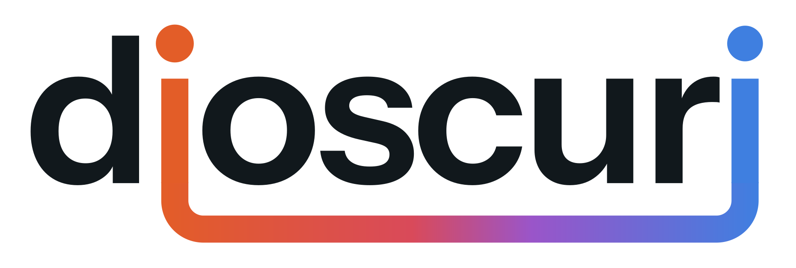

# Dioscuri: logo



The logo is the word "dioscuri" with its two i's joined underground. Together they draw a geothermal doublet.

- **The first i is the producer well.** Its dot is Pollux, the orange twin. Pollux is the brighter star in the night sky, so its dot is a touch bigger.
- **The last i is the injector well.** Its dot is Castor, the blue twin.
- **The loop below the baseline is the reservoir.** It is coloured by the brine's temperature as it circulates: cold down the injector, warming in the reservoir, hot up the producer.

In motion (`svg/dioscuri-logo-animated.svg`), a glint of brine runs that loop.

## Files

| File | Use |
|---|---|
| `svg/dioscuri-logo.svg` | Main logo on light backgrounds (`png/dioscuri-logo@4x.png`) |
| `svg/dioscuri-logo-white.svg` | On dark backgrounds (`png/dioscuri-logo-white@4x.png`) |
| `svg/dioscuri-logo-mono.svg` | One colour, for print or embossing (`png/dioscuri-logo-mono@4x.png`) |
| `svg/dioscuri-logo-mono-white.svg` | One colour, reversed (for example on the orange) |
| `svg/dioscuri-logo-animated.svg`, `…-animated-white.svg` | The loop in motion, for the web, README and video. Animates in browsers |
| `svg/dioscuri-avatar.svg` | Square, for the GitHub avatar and slides (`png/dioscuri-avatar-1024.png`, `-512.png`) |

The letters are outlined, so the files look the same without the font installed.

## Colour and type

| Name | Hex |
|---|---|
| Pollux, hot | `#E35D28` |
| Thermal stops | `#D94A5A`, `#9A55C9` |
| Castor, cold | `#3F7FE0` |
| Ink | `#11181C` |
| Paper | `#F4F2EE` |

Pollux and Castor reach at least 3:1 contrast on white, paper and ink. The type is Instrument Sans SemiBold (weight 620, tracked −2.2%), the same family as the app.

## Rules

- Keep the loop and both dots. Don't recolour the i's separately from their dots.
- On photos or busy backgrounds, use a mono version.
- The app header uses the logo at 22 px. Below about 14 px, use the avatar instead.

## Regenerate

`make_logo.py` builds every file from code. Install `cairosvg` and `fonttools`, download Instrument Sans from Google Fonts, then run:

```bash
python make_logo.py "InstrumentSans[wdth,wght].ttf"
```

The animated presentation with the anatomy is the "Dioscuri logo" board on the UI canvas (`../design/ui-prototype/Brand.dc.html`).
