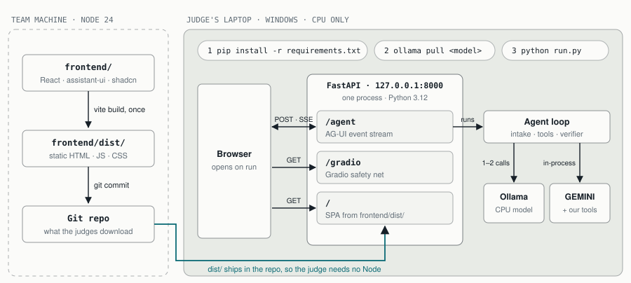
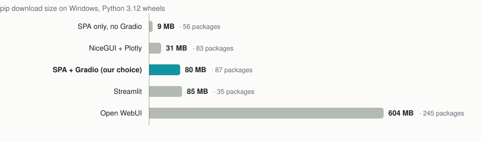
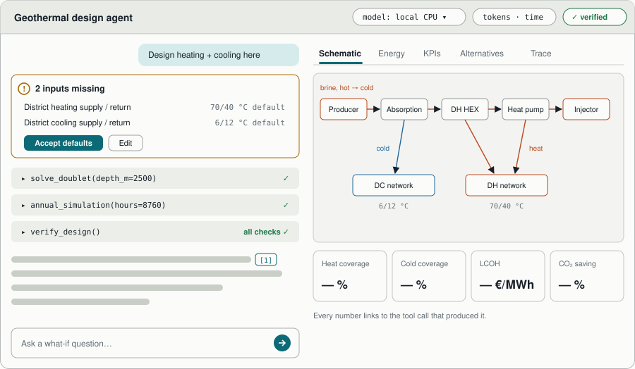

# ADR-0003: UI stack = Gradio safety net first, assistant-ui SPA as the front door

- Status: **accepted** (27 Oct 2026, provisional: revisit after the 28 Oct bootcamp)
- Evidence: [research/ui_design_skills_2026-10-27.md](../research/ui_design_skills_2026-10-27.md) (§0, §0b)

## Context

- The judges install and run our code on Windows laptops with only `pip install -r requirements.txt`
  and Ollama, and they time it. A submission that failed to run was penalised in 2025.
- Both GUI-praised 2025 podium teams used Gradio.
- Reza wants a modern agentic UI: streaming, collapsible reasoning, tool-call cards, charts, a
  schematic, a token meter and approvals.

## Decision

*Judges only ever run Python and Ollama. The front end is built once on the team machine and ships as static files. One FastAPI process serves the page, the Gradio fallback and the agent's event stream.*

1. **One Python process on one port** (FastAPI):
   - `/agent`: AG-UI endpoint. Our state machine (ADR-0002) emits AG-UI events through the
     `ag-ui-protocol` encoder; `ag-ui-langgraph` is only needed if we adopt LangGraph;
   - `/gradio`: the fallback UI;
   - `/`: the SPA as static files.

   Start everything with `python run.py`, which also opens the browser.
2. **Gradio `ChatInterface` first (D1–D2)** as the zero-risk safety net. It covers nested tool
   steps, inline Plotly, KPI tables and approve/reject buttons.
3. **assistant-ui SPA** (MIT; Vite + React + shadcn) as the polished front door. It is built on
   the team machine and **the `frontend/dist/` bundle is committed**, so judges never need Node.
4. **Python 3.12** on the judge path:
   - GEMINI declares `<3.13`;
   - Python 3.15 currently lacks Windows wheels for PyYAML and zstandard;
   - `run.py` refuses other versions with a clear message.
5. **Windows CI smoke test.** A `windows-latest` job (manual trigger) installs, starts the
   server and fetches `/` and `/gradio`.
6. Charts and schematic:
   - Plotly `scattergl` for 8760-h series (downsampled for overviews);
   - React Flow or Mermaid for the plant schematic, generated from project JSON;
   - shadcn Table for KPIs.
7. No runtime CDN or Google Fonts; assets are bundled, so the app works offline.

## Ruled out

*pip download size on Windows (Python 3.12 wheels), from the UI research. Download size, not installed size. Reflex (9 MB, but it downloads Bun and runs an npm build on first start) and Chainlit (archived, not wheel-only) are left out because their problem isn't size.*

- **Chainlit:** archived Oct 2026.
- **Mesop:** unmaintained.
- **Reflex:** downloads Bun or npm on first run.
- **Open WebUI:** about 600 MB.
- **LibreChat:** needs Node and MongoDB.
- **CopilotKit:** Node runtime, or an enterprise-tier mode.
- **Next.js:** a server isn't needed; Vite static is enough.

## What the front door looks like

*Wireframe: the conversation and the agent's steps on the left, the design workspace on the right. Labels and values are placeholders; the full brief is in [ui_design_kickoff.md](../ui_design_kickoff.md).*

## Consequences

- The team machine needs **Node 24**
  (`nvm install 24 --reinstall-packages-from=18.20.8 && nvm alias default 24`); judges don't.
- FastAPI is a new dependency compared with GEMINI's Flask. For upstream, the same bundle can
  ship as a Vite library-mode widget that replaces `chatpopup` inside a Flask blueprint
  (research §4).
- **Day-1 spike.** Check that streamed text and per-turn token usage pass cleanly from Ollama
  through our loop into AG-UI events. Usage goes out as an AG-UI `CUSTOM` event, built from
  Ollama's `prompt_eval_count` and `eval_count`.
